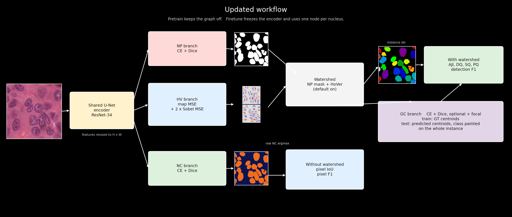

# UNet-HoVerGNN: Structured Graph Integration into HoVerNet for Enhanced Nuclei Segmentation and Classification

**Update:** This work has been accepted for presentation and publishing on 2025 International Conference on Machine Vision (ICMV 2025)! 🎉


## Updated workflow



The first figure is the published UNet-HoVerGNN pipeline. The figure above keeps that shared encoder and the NP, HV, NC, and GC branches, and shows the training and scoring path now in the code.

- **Loss.** NP and NC are cross-entropy plus the HoVer-Net global Dice loss. HV is mean-squared error on the horizontal and vertical maps, plus a weight-2 Sobel gradient term on nuclear pixels only: the x-derivative of the horizontal map and the y-derivative of the vertical map. This is the HoVer-Net map and gradient loss (Graham et al., 2019), in place of the earlier Laplacian penalty on the predicted maps.
- **Graph.** Finetune places one node at each ground-truth centroid. At validation and test the GNN class of each predicted centroid is painted onto that watershed instance. Encoder features are resized to the input resolution. The default graph loss is cross-entropy plus Dice. `HoverLoss(graph_loss="gc")` adds the original focal term for comparison.
- **Scores.** With the watershed on, which is the default, validation reports AJI (Kumar et al., 2017), panoptic DQ, SQ, and PQ at IoU > 0.5 (Kirillov et al., 2019), and centroid detection F1 at 12 px, the HoVer-Net 40× radius (Graham et al., 2019). Early stopping uses PQ. `--no-post-process` scores the raw NC argmax with pixel IoU and pixel F1, and each saved test figure shows both views.
- **Ground truth.** `inst.npy` supplies instance ids when it is present, as on MoNuSeg. Otherwise instances are rebuilt from the stored hover maps with the same watershed.

Graham, S., Vu, Q. D., Raza, S. E. A., Azam, A., Tsang, Y. W., Kwak, J. T., & Rajpoot, N. (2019). Hover-Net: Simultaneous segmentation and classification of nuclei in multi-tissue histology images. *Medical Image Analysis, 58*, 101563. [https://doi.org/10.1016/j.media.2019.101563](https://doi.org/10.1016/j.media.2019.101563)

Kirillov, A., He, K., Girshick, R., Rother, C., & Dollár, P. (2019). Panoptic segmentation. In *Proceedings of the IEEE/CVF Conference on Computer Vision and Pattern Recognition* (pp. 9404–9413).

Kumar, N., Verma, R., Sharma, S., Bhargava, S., Vahadane, A., & Sethi, A. (2017). A dataset and a technique for generalized nuclear segmentation for computational pathology. *IEEE Transactions on Medical Imaging, 36*(7), 1550–1560. [https://doi.org/10.1109/TMI.2017.2677499](https://doi.org/10.1109/TMI.2017.2677499)

---


## Original Abstract

We propose **UNet-HoVerGNN**, a hybrid framework for nuclei instance segmentation and classification that combines CNN-based segmentation with graph-based reasoning. Nuclei centroids are used to construct $k$-nearest neighbor graphs, where node and edge features are extracted from a pretrained U-Net encoder. A GNN refines classification by capturing spatial and contextual dependencies. Evaluated on MoNuSAC, PanNuke, and CoNSeP, our model achieves strong results: 0.603 AJI, 0.641 F1, 0.622 PQ on MoNuSAC; 0.644 AJI, 0.682 F1, 0.661 PQ on PanNuke; and 0.585 AJI, 0.608 F1, 0.595 PQ on CoNSeP, outperforming or matching state-of-the-art models like HoVerNet and similar graph-based methods. Code is available at: **[GitHub Repository](https://github.com/YangTuanAnh/UNet-HoVerGNN)**
**[Dataset on Kaggle](https://www.kaggle.com/datasets/yangtunanh/monusac-pannuke-consep/data)**
**[Models on Kaggle](https://www.kaggle.com/models/yangtunanh/hovergnn-monusac/)**
**[Reproduced experiments](https://www.kaggle.com/code/yangtunanh/unet-hovergnn-reproducibility)**

---


## Dataset Setup

Install dependencies, then place datasets under a common root (default `../data` when running from `src/`). Each dataset folder must contain `train/`, `val/`, and `test/` splits. Every sample is a directory with:


| File                     | Shape / notes                                                               |
| ------------------------ | --------------------------------------------------------------------------- |
| `image.npy`              | H×W×3 RGB                                                                   |
| `mask.npy`               | H×W class labels (0 = background)                                           |
| `h_map.npy`, `v_map.npy` | H×W horizontal / vertical distance maps (uint8, scaled)                     |
| `inst.npy`               | H×W instance ids (optional; negative ids rebuild instances from hover maps) |


### Classification datasets (Kaggle)

Download [MoNuSAC / PanNuke / CoNSeP](https://www.kaggle.com/datasets/yangtunanh/monusac-pannuke-consep/data) and point `--data_path` at the folder that contains the dataset subdirectories, or at the dataset directory itself when `train/`, `val/`, and `test/` are already inside it.


| Dataset        | `--dataset`    | `--num_classes` |
| -------------- | -------------- | --------------- |
| MoNuSAC        | `MoNuSAC`      | 5               |
| PanNuke        | `PanNuke`      | 6               |
| CoNSeP (tiled) | `CoNSeP_Tiled` | 8               |


### MoNuSeg (segmentation only)

MoNuSeg has no nuclear type labels, so use `--num_classes 2` (background + nucleus).

**Official Kumar / 2018 split (**`MoNuSeg`**)** — download archives and write 256×256 tiles (also writes `MoNuSeg_Test2018`):

```sh
cd src
python prepare_monuseg.py
```

This produces `data/MoNuSeg/{train,val,test}/` with the HoVer-Net Kumar split (16 train / 4 val / 14 test images, tiled). Instance maps come from the official XML contours.

**37-image** `img` **/** `labelcol` **dump (**`MoNuSeg_37`**)** — place the raw tree at `data/MoNuSeg_37/` as:

```text
data/MoNuSeg_37/
  train/{img,labelcol}/
  validate/{img,labelcol}/
  test/{img,labelcol}/
```

Then convert to the same tiled `.npy` layout (stages the raw folders under `data/MoNuSeg_37/raw/` and maps `validate` → `val`):

```sh
cd src
# Prefer instance XMLs from a prior prepare_monuseg.py run (data/MoNuSeg/raw).
# Without XMLs, connected components on the binary labelcol masks are used.
python prepare_monuseg37.py
```


| Dataset               | `--dataset`  | `--num_classes` | Prep script            |
| --------------------- | ------------ | --------------- | ---------------------- |
| MoNuSeg (Kumar split) | `MoNuSeg`    | 2               | `prepare_monuseg.py`   |
| MoNuSeg 37-image dump | `MoNuSeg_37` | 2               | `prepare_monuseg37.py` |


---


## Training and Evaluation

```sh
cd src
python -m venv .venv
source .venv/bin/activate
# ".venv/Scripts/activate" (Windows)
pip install -r requirements.txt

python main.py --dataset MoNuSAC --num_classes 5 \
               --data_path /path/to/data \
               --output_path /path/to/output

python main.py --dataset PanNuke --num_classes 6 \
               --data_path /path/to/data \
               --output_path /path/to/output

python main.py --dataset CoNSeP_Tiled --num_classes 8 \
               --data_path /path/to/data \
               --output_path /path/to/output

python main.py --dataset MoNuSeg --num_classes 2 \
               --data_path ../data \
               --output_path ../output

python main.py --dataset MoNuSeg_37 --num_classes 2 \
               --data_path ../data \
               --output_path ../output
```

Useful CLI flags (see `config.py` for defaults):


| Flag                                   | Meaning                                                                                  |
| -------------------------------------- | ---------------------------------------------------------------------------------------- |
| `--epochs N`                           | Epochs per stage (pretrain and finetune each run this many; default 25)                  |
| `--post_process` / `--no-post-process` | Score with HoVer-Net watershed instances (default), or raw NC argmax with pixel IoU / F1 |


Training runs a CNN pretrain stage, then a GNN finetune stage, with early stopping on validation. Checkpoints, CSV metrics, and validation figures are written under `--output_path`.

### Metrics and post-processing

Validation and test scoring follow HoVer-Net-style instance metrics (`src/metrics.py`):

- **AJI** — MoNuSeg / HoVer-Net fast Aggregated Jaccard Index
- **PQ / DQ / SQ** — panoptic quality with unique IoU > 0.5 matches
- **Detection F1** — centroid matching at `MATCH_RADIUS` (12 px at 40×)

By default, predictions are watershed-separated from the nuclear / hover heads before scoring (`src/postprocess.py`). Use `--no-post-process` to inspect raw class maps without watershed.

Optional GPU memory probe for tile vs full-image footprints:

```sh
python memory_probe.py
```

---


## Performance Comparison


| **Model**           | **AJI**     | **F1**    | **PQ**    | **AJI**     | **F1**    | **PQ**    | **AJI**    | **F1**    | **PQ**    |
| ------------------- | ----------- | --------- | --------- | ----------- | --------- | --------- | ---------- | --------- | --------- |
|                     | **MoNuSAC** |           |           | **PanNuke** |           |           | **CoNSeP** |           |           |
| HoVerNet            | 0.599       | 0.613     | 0.604     | **0.653**   | 0.621     | 0.503     | 0.544      | 0.510     | 0.549     |
| Mask2Former         | 0.577       | 0.568     | 0.559     | 0.616       | 0.666     | 0.480     | 0.464      | 0.482     | 0.414     |
| TSFD-net            | 0.461       | 0.499     | 0.350     | 0.621       | 0.513     | 0.413     | 0.458      | 0.415     | 0.439     |
| SENC (HoVerNet)     | 0.599       | 0.613     | **0.692** | **0.653**   | 0.621     | 0.528     | 0.544      | 0.510     | **0.595** |
| **Ours (Pretrain)** | 0.230       | 0.271     | 0.248     | **0.653**   | **0.695** | **0.672** | 0.484      | 0.498     | 0.490     |
| **Ours (Finetune)** | **0.603**   | **0.641** | 0.622     | 0.644       | 0.682     | 0.661     | **0.585**  | **0.608** | **0.595** |


---


## Recent changes

- **MoNuSeg / MoNuSeg_37** — segmentation-only training (`num_classes=2`) with preparation scripts that write the shared tiled `.npy` layout.
- `prepare_monuseg.py` — downloads official archives and tiles the Kumar train/val/test split (plus MoNuSeg 2018 test).
- `prepare_monuseg37.py` — converts an `img` / `labelcol` dump into tiled samples; uses XML instances when `data/MoNuSeg/raw` is present.
- **HoVer-Net metrics** — AJI, PQ/DQ/SQ, and radius-based detection F1 in `metrics.py`.
- **Watershed post-process** — optional via `--post_process` / `--no-post-process` for validation and final eval.
- **Training / eval CLI** — `--epochs`, configurable output path, CSV metrics and sample visualizations.
- **Instance targets** — `inst.npy` when available; otherwise instances are rebuilt from hover maps for metric computation.

